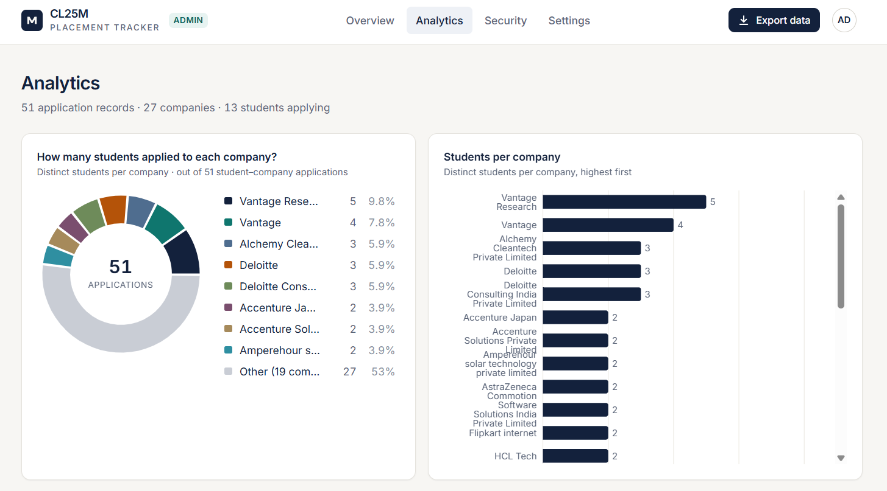
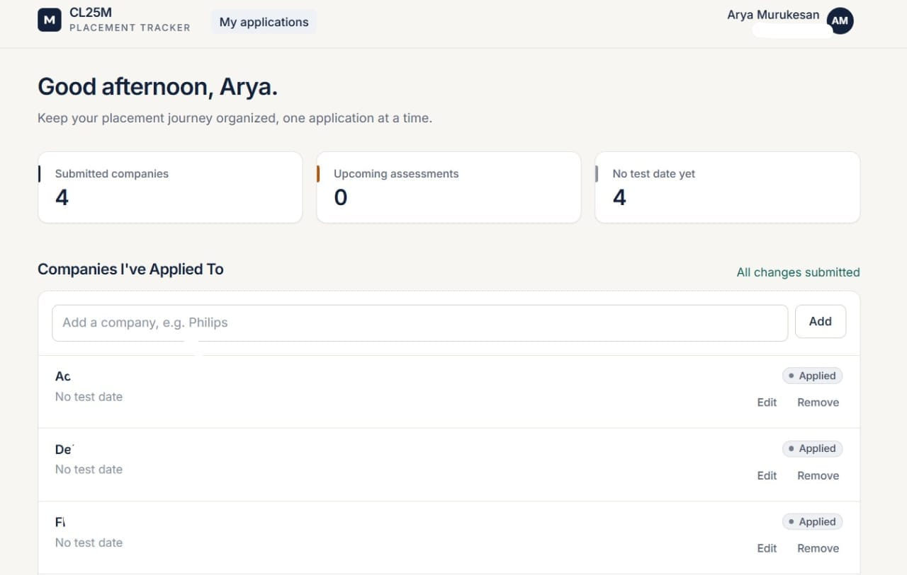
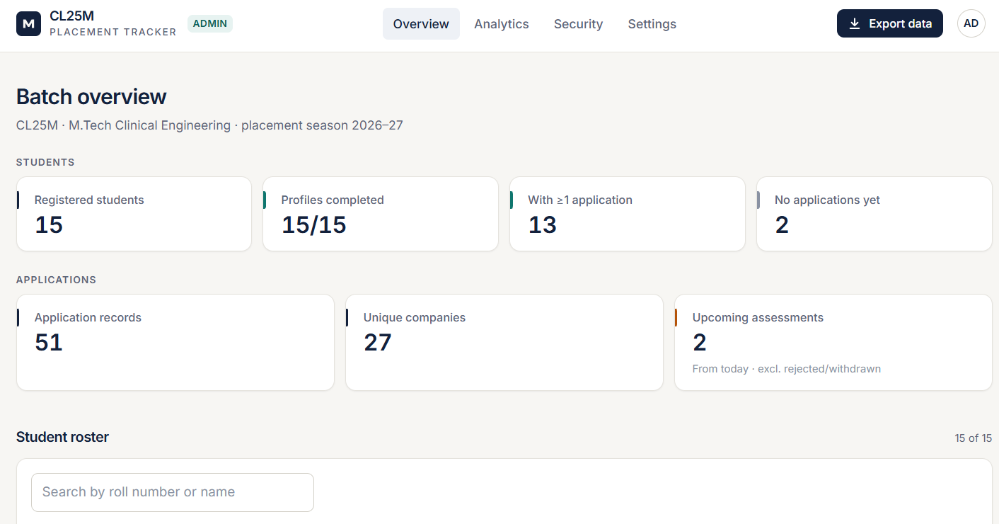
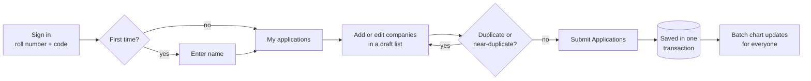
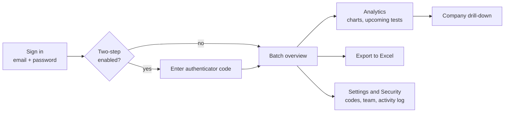
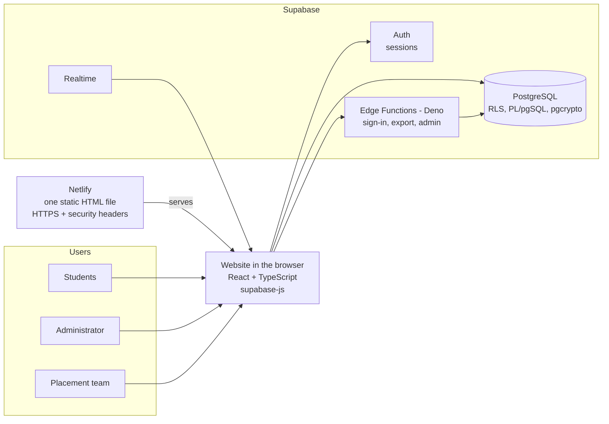
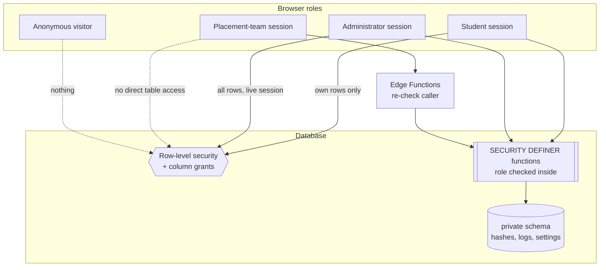
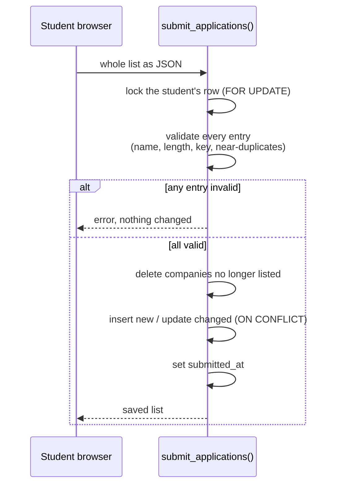
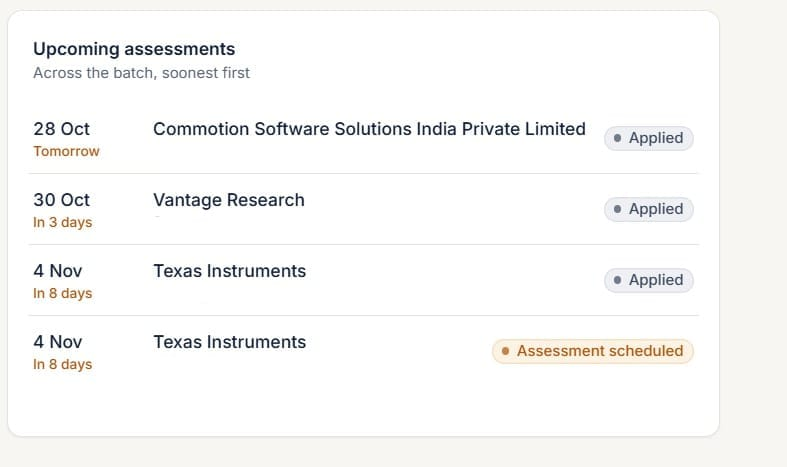

<div align="center">

# CL25M Placement Tracker

**A real-time placement application tracking and coordination platform**

Built for the 2026–27 M.Tech Clinical Engineering placement batch at IIT Madras




</div>

---

## Contents

1. [Overview](#1-overview)
2. [The problem](#2-the-problem)
3. [Objectives and requirements](#3-objectives-and-requirements)
4. [Implemented features](#4-implemented-features)
5. [Workflows](#5-workflows)
6. [System architecture](#6-system-architecture)
7. [Technology stack](#7-technology-stack)
8. [Database and security architecture](#8-database-and-security-architecture)
9. [Company-name matching](#9-company-name-matching)
10. [Transactional submission](#10-transactional-submission)
11. [Privacy-preserving analytics](#11-privacy-preserving-analytics)
12. [Assessment monitoring](#12-assessment-monitoring)
13. [Excel reporting](#13-excel-reporting)
14. [Testing and validation](#14-testing-and-validation)
15. [Development timeline](#15-development-timeline)
16. [Challenges and resolutions](#16-challenges-and-resolutions)
17. [Installation and setup](#17-installation-and-setup)
18. [Deployment](#18-deployment)
19. [Known limitations](#19-known-limitations)
20. [Development contribution and AI-assisted workflow](#20-development-contribution-and-ai-assisted-workflow)

Detailed write-ups for each topic are in [`docs/`](docs).

---

## 1. Overview

CL25M Placement Tracker gives a 15-student postgraduate batch one shared, private and live record of placement applications. Students record the companies they have applied to; the batch sees anonymous company-wise totals; the placement coordinator (administrator) sees every application, upcoming assessments and analytics, and can export everything to Excel.

| | |
| --- | --- |
| **Users** | 15 students (fixed roll numbers), 1 administrator, an approved placement team |
| **Built** | 26 October – 1 November 2026, during the live placement drive |
| **Hosting** | Netlify (static website) + Supabase (database, sign-in, server functions), free tiers |
| **Verification** | 133 automated tests and 38 end-to-end browser checks, all passing at release |

> The live deployment address is intentionally not published: the application holds a real batch's data and is for that batch only.

---

## 2. The problem

> *How can a small postgraduate batch maintain a reliable, centralised and privacy-conscious record of placement applications, company-wise participation and upcoming assessments, while giving its placement coordinator actionable visibility into the placement season?*

Students applied independently to many companies through different channels, including off-campus opportunities whose assessment dates had to be tracked alongside other batch activities. As placement coordinator, I faced:

- Application information scattered across WhatsApp conversations, personal notes and individual records.
- No reliable consolidated view of which students had applied to which companies.
- The same company written many ways ("Commotion", "commotion", "Commotion Pvt. Ltd."), making manual counts unreliable.
- No central view of assessment dates.
- A need to keep each student's applications private from classmates.
- No consolidated student-interest figures to show companies when asking them to open opportunities for Biomedical and Clinical Engineering students.

More in [docs/problem-statement.md](docs/problem-statement.md).

---

## 3. Objectives and requirements

| # | Requirement | How it is met |
| --- | --- | --- |
| R1 | Exactly the 15 authorised students (CL25M001–CL25M016, no CL25M014) | Roll numbers fixed by a database check constraint |
| R2 | Simple sign-in without email | Roll number + personal access code, verified server-side |
| R3 | Students see only their own records | PostgreSQL row-level security |
| R4 | Batch picture without exposing individuals | Aggregate-only statistics function; distinct-student counts |
| R5 | Spelling-tolerant company names | Normalisation key + optimal string alignment distance |
| R6 | Deliberate, reviewable saving | Draft list + explicit **Submit Applications** |
| R7 | Separate administrator workspace | Email/password sign-in, overview, analytics, export |
| R8 | Excel reporting | Server-built three-sheet workbook |
| R9 | Works for everyone over the internet at no cost | Supabase + Netlify free tiers, no custom server |
| R10 | Data protection | Hashed codes, throttling, column grants, activity log, CSP |
| R11 | Verified behaviour | Database, server-logic and browser test suites |

---

## 4. Implemented features

### Students



- Sign in with roll number and personal access code; enter a name on first sign-in.
- Add companies to a **draft list** with role, application stage, assessment date and notes.
- Duplicate and near-duplicate entries are flagged while typing ("Already in your list as …") and refused by the server.
- Edit or remove entries, then press **Submit Applications** to save the whole list.
- View own applications and a batch chart of **how many students applied to each company** (counts only, unlocked after the first submission). The chart refreshes every 30 seconds and when the tab regains focus.

### Administrator



- Separate email-and-password sign-in through a throttled server function; optional authenticator-app two-step verification.
- Batch overview: registered students, completed profiles, students with and without applications, application records, unique companies, upcoming assessments, roster with last activity.
- Analytics: company pie chart, students-per-company bar chart, application-stage distribution, company metrics, upcoming assessments.
- Company-level drill-down: click a company to list its applicants.
- Live refresh through Supabase Realtime, plus a 60-second refresh.
- Three-sheet Excel export.
- Access-code reset (single student or all), sign-out of a student's sessions.
- Placement-team management, security alerts, outreach records and an activity log.

### Placement team

From the source code (`src/pages/coordinator`, `supabase/functions/_shared/coordinator.ts`):

- Issued individually by the administrator; first sign-in requires choosing a 6-digit PIN and an own password, then registering one computer.
- Sees batch totals, the company chart, stage counts and upcoming assessments (date, company, stage; no identities).
- Sees roll numbers (never names) only for companies the administrator assigns, or for all companies if granted.
- Exports one company's applicant list at a time; records outreach status and next actions for assigned companies.

---

## 5. Workflows

### Student



### Administrator



---

## 6. System architecture



There is no custom server. The browser calls Supabase directly with a public (publishable) key; every access rule lives in the database. Actions that need privileged keys (sign-in, Excel export, credential and team management) run in Edge Functions, which re-check the caller's rights on every request. See [docs/system-architecture.md](docs/system-architecture.md).

---

## 7. Technology stack

| Layer | Technology | Where it is used |
| --- | --- | --- |
| Frontend | React 18, TypeScript 5, Vite 5 | `src/`, `vite.config.ts` |
| | Tailwind CSS 3 | Styling (navy, teal, amber theme) |
| | Recharts 2 | Pie, bar and stage charts |
| | React Router 6 | Browser, hash and in-memory routing modes |
| | vite-plugin-singlefile | Single-file web and offline builds |
| | WebCrypto, IndexedDB | Placement-team device keys; offline version storage |
| Backend | Supabase PostgreSQL, PL/pgSQL | `supabase/migrations/` |
| | Row-Level Security, column grants | Role-based access in the database |
| | pgcrypto (bcrypt) | Access-code and PIN hashing |
| | Supabase Auth, Realtime | Sessions; live admin updates |
| | Supabase Edge Functions (Deno) | `supabase/functions/` |
| | supabase-js 2 | Browser and function client |
| | ExcelJS 4 | `supabase/functions/_shared/workbook.ts` |
| | esbuild | `scripts/bundle-functions.mjs` |
| Testing | Vitest 2, PGlite | `tests/*.test.ts` |
| | Playwright + Chromium | `tests/e2e/run.ts` (Playwright installed separately) |
| | Deno 2.1 type-check | Edge Functions, before deployment |
| | detect-secrets | Secret scan of source and build |
| Hosting | Netlify, Supabase | Website; database and functions |
| Development | Claude (Anthropic) | AI coding assistant (see section 20) |

During development, puppeteer-core with @sparticuz/chromium was also used for walkthrough screenshots of the offline build; those scripts are not part of this repository.

---

## 8. Database and security architecture



| Control | Implementation |
| --- | --- |
| Code storage | bcrypt hashes via pgcrypto; plain codes never stored |
| Student sign-in throttling | 5 failures per roll number or 30 per network in 15 minutes; identical message for unknown roll and wrong code |
| Staff sign-in throttling | 5 failures per account or 30 per network in 15 minutes, through the `staff-login` function |
| Row-level security | `students`, `applications`: own rows, or administrator with a live session |
| Column grants | The `name` column is not readable from the browser; names come only through `my_profile()` (own) and `admin_student_names()` (administrator) |
| Administrator check | `is_admin()` requires the admins table, a still-existing session and, once enrolled, two-step verification |
| Function exposure | Every function's grants set explicitly; anonymous users can call only four text helpers |
| Activity log | Append-only table guarded by a trigger; readable only by the administrator; 180-day retention |
| Spreadsheet safety | Text starting with `=`, `+`, `-` or `@` stored with a leading apostrophe |
| Website headers | Hash-pinned Content-Security-Policy, frame denial, no-referrer (`scripts/security-headers.mjs`) |

Schema and tables: [docs/database-design.md](docs/database-design.md). Security detail: [docs/security-implementation.md](docs/security-implementation.md).

---

## 9. Company-name matching

Students type company names freely. Two steps make "Commotion", "commotion" and "COMMOTION Pvt. Ltd." count as one company:

1. **Normalisation key** (`company_key` in SQL, `companyMatchKey` in TypeScript): lower case; accents split off and removed; `&` → `and`; everything except `a–z` and `0–9` removed; trailing legal and generic words (pvt, private, ltd, limited, llp, llc, inc, corp, co, company, plc, gmbh, ag, sa, bv, india, technologies, technology, tech) dropped while at least one word remains.
2. **Typo tolerance** (`same_company_key`): optimal string alignment (Damerau–Levenshtein) distance between keys, allowed up to **0** for names of 4 letters or fewer, **1** up to 8, **2** beyond. The first letter and all digits must match, so "Company 1" and "Company 2" stay separate.

Groups are formed by assigning each key to the first, most-used group it matches. The SQL and TypeScript versions are tested against each other. Details: [docs/company-normalisation.md](docs/company-normalisation.md).

---

## 10. Transactional submission



Students cannot write to the applications table directly; the only write path is this function. A unique index on (student, company key) guarantees one entry per company. Resubmitting the same list changes nothing.

---

## 11. Privacy-preserving analytics

- `company_application_stats()` returns only company name, number of distinct students and percentage. It never returns IDs, names or roll numbers.
- Students see it only after their own first submission.
- Percentages are out of all distinct student–company applications.
- The administrator's analytics read the full data under administrator-only row-level security.

---

## 12. Assessment monitoring



Each application can carry an assessment date (2020–2035). The administrator sees upcoming assessments across the batch, soonest first, with a relative day ("Tomorrow", "In 3 days") and the stage. Rejected and withdrawn applications are left out. Students see their own count of upcoming assessments.

---

## 13. Excel reporting

The `admin-export` Edge Function re-checks administrator rights, reads with the administrator's own token and builds the workbook on the server with ExcelJS:

| Sheet | Columns |
| --- | --- |
| Student Roster | Roll number, student name, number of applications, upcoming assessments, last updated (IST) |
| Company Applications | Roll number, student name, company, role, application stage, test date, notes, created and last updated (IST) |
| Company Analytics | Match key, display name, total applications, distinct students, percentage of total, spellings grouped |

Each export is recorded in the activity log. See [docs/analytics-and-reporting.md](docs/analytics-and-reporting.md).

---

## 14. Testing and validation

All suites passed at release (133/133 tests, 38/38 browser checks). Database suites load the real migration files into PGlite, an in-memory PostgreSQL, with stand-ins for the Supabase roles, so they test the rules the live database enforces.

| Suite | File | Tests | Validates |
| --- | --- | --- | --- |
| Database rules | `tests/db.test.ts` | 26 | Roll-number limits, throttling, RLS, hashing, two-step rules |
| Submission workflow | `tests/submissions.test.ts` | 22 | Explicit submit, duplicates, distinct counts, failed submissions change nothing, SQL/JS agreement |
| Security rules | `tests/security.test.ts` | 37 | Role permissions, team sign-in steps, sessions, audit-log immutability, alerts, rate limits, function exposure |
| Server-function logic | `tests/coordinator-api.test.ts` | 26 | Sign-in, team provisioning, exports and refusals through the real handler code |
| Company matching and analytics | `tests/analytics.test.ts` | 13 | Keys, typo groups, percentages, workbook |
| Name privacy | `tests/names.test.ts` | 8 | Names readable only by the student and the administrator |
| Offline hashing | `tests/sha256.test.ts` | 1 | SHA-256 used by the offline version |
| Browser end-to-end | `tests/e2e/run.ts` | 38 checks | Student, administrator and team flows in Chromium, served with the production security headers |

Also run before release: TypeScript type-check, production web and offline builds, Deno type-check of every Edge Function, and a detect-secrets scan. More: [docs/testing-and-validation.md](docs/testing-and-validation.md).

---

## 15. Development timeline

| Date (2026) | Release | Change |
| --- | --- | --- |
| 26 Oct | v1 | Full-stack build from the specification: 15 roll numbers, admin analytics, Excel export, tests |
| 26 Oct | v1.1 | Single-file version; case-insensitive company names |
| 26 Oct | v2 | Draft list + Submit Applications, student chart, spelling groups, live refresh |
| 26 Oct | v3 | Online launch: Supabase project, Edge Functions, Netlify site; one shared database |
| 27 Oct | Recovery | Accidental reset found; setup script given a safety stop |
| 27 Oct | v4 | Student names readable only by the student and the administrator |
| 29 Oct | v5 | Security hardening: staff sign-in, activity log, alerts, rate limits, CSP, permission review |
| 29 Oct | v6 | Company drill-down for the placement team; per-application upcoming list |
| 1 Nov | Docs | Technical report |

Full history: [docs/development-timeline.md](docs/development-timeline.md).

---

## 16. Challenges and resolutions

| Challenge | Cause | Resolution |
| --- | --- | --- |
| Classmates could not open the first build | A multi-file app needs a server | Single self-contained HTML file, then a hosted site |
| "Invalid URL", frozen sign-in, admin 404 in preview panels | Preview frames have no usable address | Router falls back to in-memory mode; custom form and link components |
| Each device saw different data | Offline version stores data in the browser | Moved to one shared Supabase database |
| "type already exists" during database setup | Partial earlier run and a hidden non-ASCII character | Repeatable, ASCII-only setup script |
| Functions could not find keys | Supabase's new key format | Key reader accepting old and new formats |
| Administrator sign-in refused | Account unconfirmed / not in the admins table | Confirmed and registered via SQL |
| Data reset on 27 Oct | Setup script re-run on the live project | Script now refuses to run when data exists |
| "Company 1" merged with "Company 2" | Typo tolerance too loose | Digits must match |
| Authenticator codes rejected for a team member | Phone clock and repeated QR setups | Team second step changed to a 6-digit PIN |
| Spreadsheet formula injection | Cells beginning with `=` | Formula-like text stored as text |

---

## 17. Installation and setup

**Requires:** Node.js 20+, a Supabase project.

```bash
npm install
cp .env.example .env          # set VITE_SUPABASE_URL and VITE_SUPABASE_ANON_KEY (publishable key)
npm run dev                   # local development server
```

Database: run every file in `supabase/migrations/` in name order in the Supabase SQL editor. For local testing only, run `supabase/prototype-codes.sql` (made-up demo codes).

```bash
npm test                      # 133 tests (no Supabase needed)
npm run typecheck
npm run build:offline         # one HTML file that runs without a server (demo)
```

---

## 18. Deployment

1. Create the administrator in Supabase Auth and add their user id to `public.admins`.
2. Deploy the six functions in `supabase/functions/` with JWT verification off (each checks its caller itself; see `supabase/config.toml`). Either `supabase functions deploy <name>`, or `npm run bundle:functions` and paste each file from `deploy/functions/` into the dashboard editor.
3. `npm run build:web`, then `node scripts/security-headers.mjs dist-web https://YOUR-PROJECT.supabase.co`, and upload `dist-web/` to Netlify.
4. Issue random student codes from **Settings → Student access codes**.

Full guide: [docs/deployment-guide.md](docs/deployment-guide.md).

---

## 19. Known limitations

- Data is self-reported; totals are only as complete as students' submissions.
- The free Supabase plan has no automatic backups and pauses projects after about a week without activity.
- Typo tolerance can, rarely, group two genuinely different but similar names; the Excel export lists every spelling grouped under each company.
- Students' charts refresh on a 30-second timer rather than through Realtime.
- No independent security review has been carried out.

More: [docs/limitations.md](docs/limitations.md).

---

## 20. Development contribution and AI-assisted workflow

This project was developed with AI assistance. Claude (Anthropic) was used as a coding assistant for source code, tests and documentation. Not all code was written by hand.

**My responsibilities as author:**

- Identifying the placement-coordination problem as the batch's placement coordinator
- Defining requirements, roles and privacy rules, and writing the specifications
- Specifying workflows and making system and design decisions
- Directing the AI-assisted development and reviewing the implementation
- Testing application behaviour, including live checks after each release
- Configuring the Supabase project and Netlify hosting
- Deploying, validating and operating the application during the placement drive
- Responding to real operational problems (preview failures, the database reset, sign-in issues)

---

<div align="center">

**Data notice:** the access codes in this repository are made-up demo values and no student records are included.

MIT Licence · © 2026 Arya Murukesan

</div>
