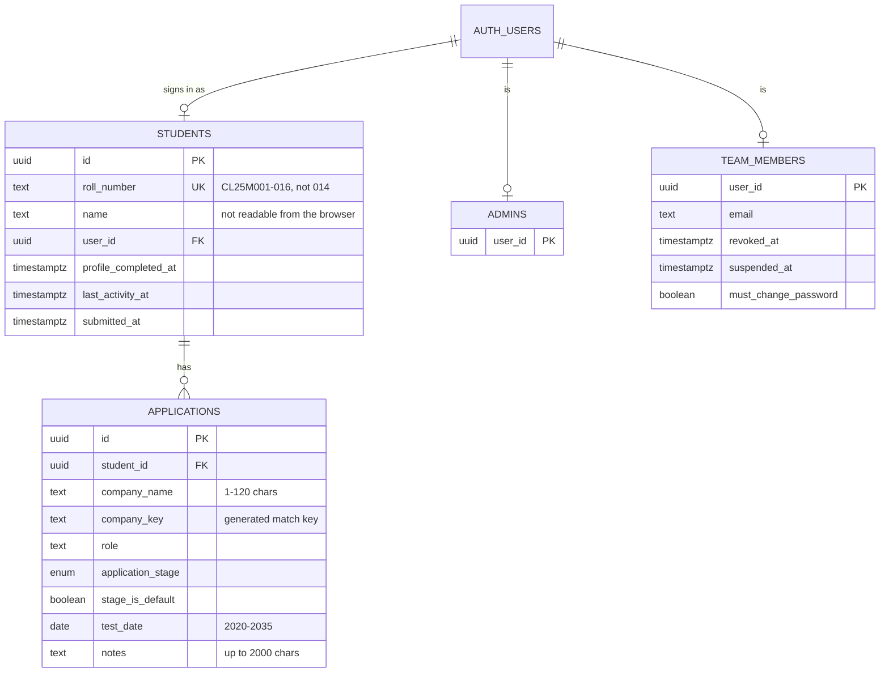

# Database design

PostgreSQL on Supabase. Schema, rules and functions are defined in `supabase/migrations/`, applied in name order:

| Migration | Adds |
| --- | --- |
| `20261026000000_init.sql` | Core tables, RLS, student sign-in and code functions, seed of the 15 roll numbers |
| `20261026100000_submissions_and_team.sql` | Company matching functions, one-entry-per-company index, `submit_applications`, aggregate statistics, placement team |
| `20261026200000_explicit_grants.sql` | Explicit server-role and schema grants |
| `20261027000000_hide_names_from_team.sql` | Column-level grants hiding `name`; `my_profile()`, `admin_student_names()` |
| `20261029000000_coordinator_security.sql` | Activity log, alerts, rate limits, staff sign-in, placement-team server functions, session check for the administrator |
| `20261029100000_coordinator_pin.sql` | 6-digit PIN as the placement team's second sign-in step |
| `20261029200000_coordinator_all_companies.sql` | "All companies" assignment; per-application upcoming list |

## Core tables (schema `public`)

- `application_stage`: applied, assessment_scheduled, interview, offer_received, rejected, withdrawn.
- Unique index on `(student_id, company_key)`: one entry per company per student.
- At most 300 applications per student (trigger).
- Triggers tidy whitespace, stamp `created_at`/`updated_at` and keep `last_activity_at` current.

## Private tables (schema `private`, never exposed through the API)

| Table | Holds |
| --- | --- |
| `student_credentials` | bcrypt hash of each student's access code |
| `login_attempts` | Student sign-in outcomes for throttling |
| `settings` | Throttling limits, retention and alert thresholds |
| `audit_events` | Append-only activity log |
| `security_alerts` | Alerts raised by rules over the activity log |
| `rate_events` | Counters for rate limits |
| `coordinator_companies`, `company_outreach` | Placement-team company assignments and outreach notes |
| `coordinator_devices`, `device_replacement_grants`, `device_nonces`, `coordinator_pin_sessions` | Placement-team registered browser, approvals, replay protection and PIN-verified sessions |

No browser or server role has direct access to the private tables; only SECURITY DEFINER functions owned by the database owner read or write them.

## Key functions

| Function | Called by | Purpose |
| --- | --- | --- |
| `submit_applications(jsonb)` | Student | Validate and save the whole list in one transaction |
| `company_application_stats()` | Student (after submitting), administrator | Company, distinct students, percentage; no identities |
| `company_key`, `osa_distance`, `same_company_key` | Internal | Spelling-tolerant matching |
| `my_profile()` | Student | Own name |
| `admin_student_names()` | Administrator | All names |
| `attempt_student_login(...)` | `student-login` function | Throttled bcrypt check |
| `admin_*` | Administrator | Credentials status, team, alerts, activity log, outreach |
| `svc_*` | Edge Functions only | Staff sign-in, placement-team requests, logging |
