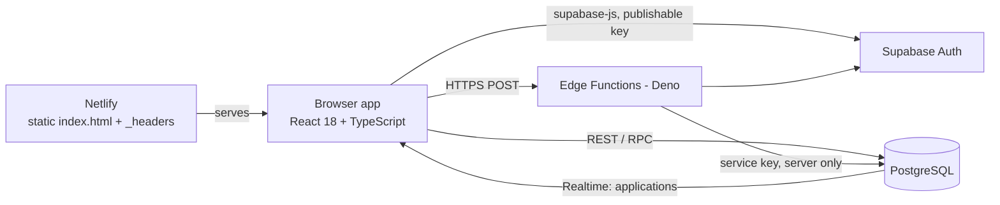
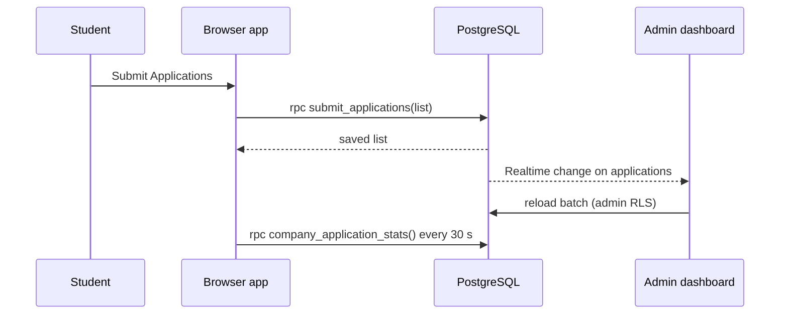

# System architecture

## Components

| Component | Role |
| --- | --- |
| Browser app (`src/`) | All screens. Built by Vite into one self-contained `index.html` (`npm run build:web`). |
| Netlify | Hosts the single file over HTTPS with security headers from `scripts/security-headers.mjs`. |
| Supabase Auth | Sessions for students, the administrator and the placement team. |
| PostgreSQL (`supabase/migrations/`) | Tables, row-level security, column grants and PL/pgSQL functions. Enforces every access rule. |
| Edge Functions (`supabase/functions/`) | Actions that need privileged keys; each re-checks its caller. |
| Supabase Realtime | Pushes changes to `applications` to the administrator's dashboard. |

## Edge Functions

| Function | Caller | Purpose |
| --- | --- | --- |
| `student-login` | Anyone | Verifies roll number + code (bcrypt, throttled), creates/links the student's Auth user on first sign-in, returns a session |
| `staff-login` | Anyone | Administrator and placement-team sign-in with throttling, generic errors and audit events |
| `admin-export` | Administrator | Builds the three-sheet Excel workbook |
| `admin-credentials` | Administrator | Resets one or all student codes; signs a student out |
| `admin-team` | Administrator | Issues and resets placement-team logins |
| `coordinator-api` | Placement team | The team's only data route; checks session, PIN, registered device, company assignment and rate limits |

Shared logic lives in `supabase/functions/_shared/` and is imported by both the Deno functions and the Node tests.

## Data flow: a student submission

## Build modes

| Command | Output | Data layer |
| --- | --- | --- |
| `npm run dev` | Dev server | Supabase |
| `npm run build:web` | `dist-web/index.html` | Supabase |
| `npm run build:offline` | `dist-offline/index.html` | Browser storage only (`src/lib/local/`), swapped in by a Vite plugin |

The router picks normal, hash or in-memory routing depending on where the page is opened, so the single file also works inside preview panels.
